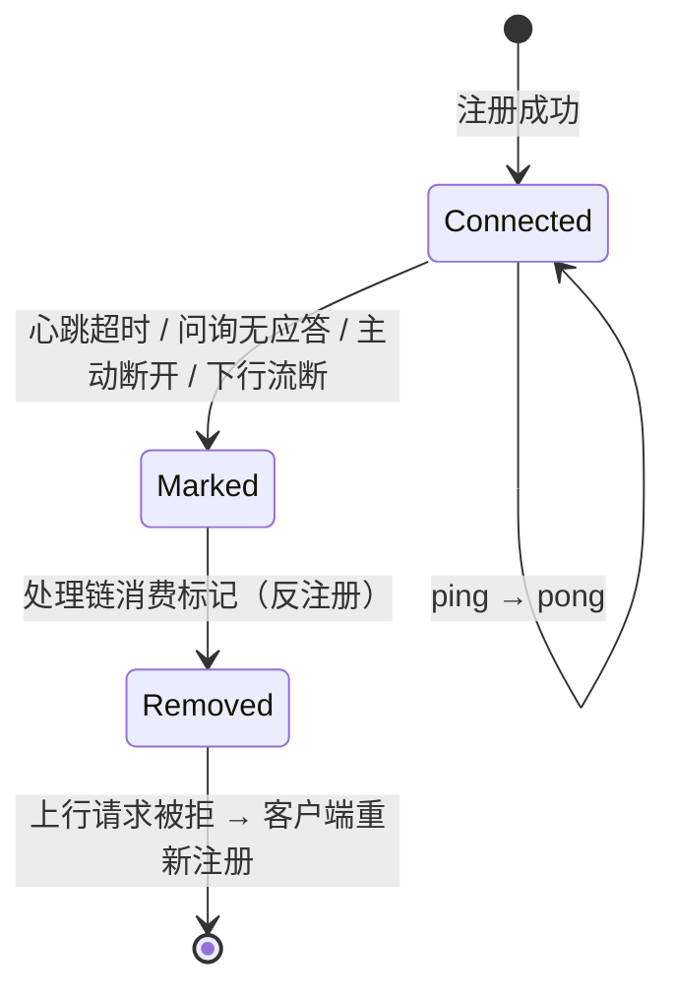
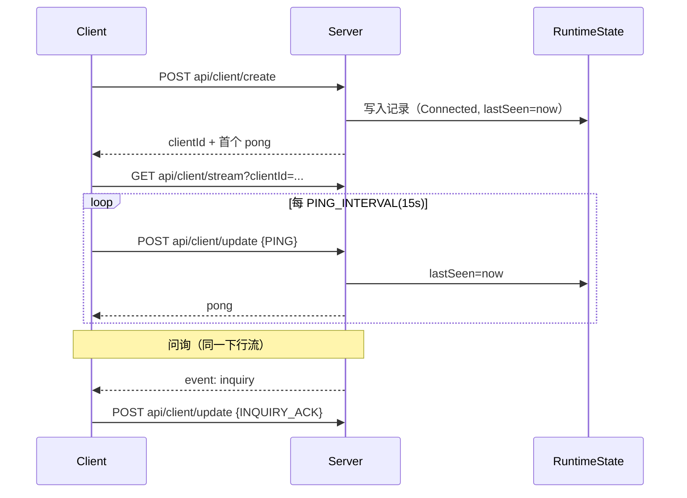
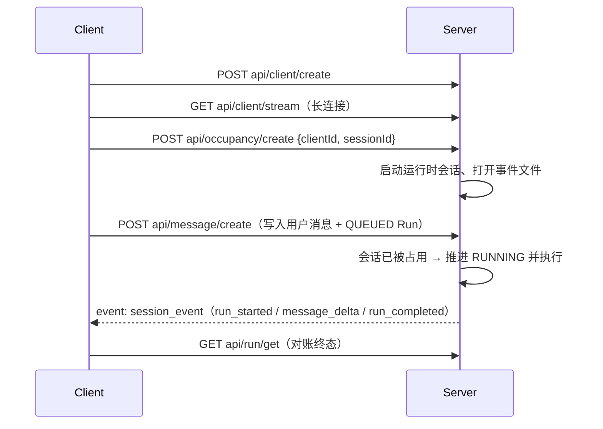
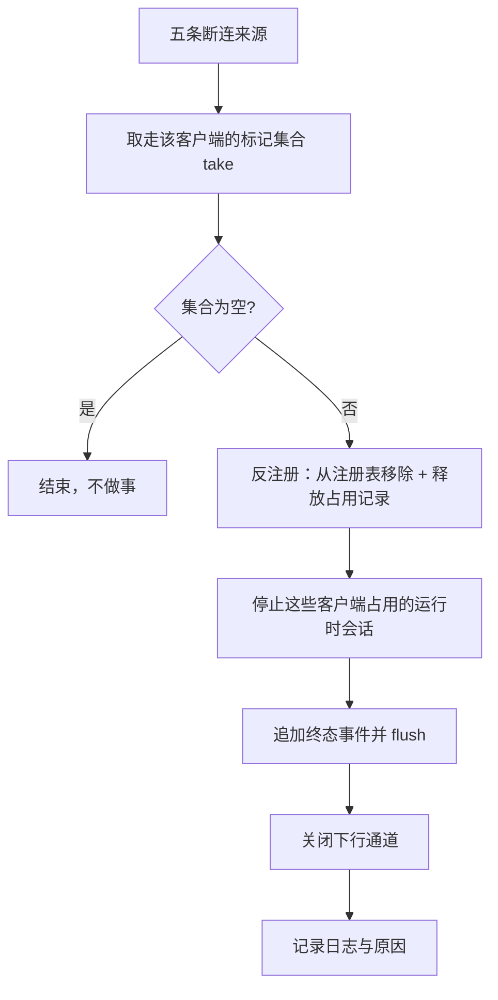
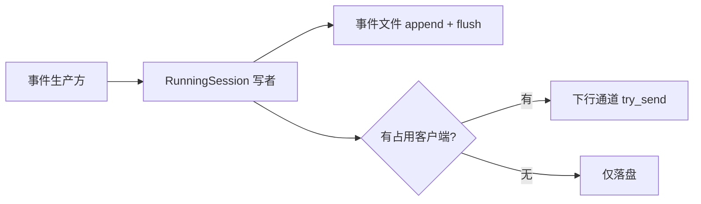

# P1.1 客户端连接与会话运行时

**状态：已完成（RT-001 ~ RT-022 全部完成，21 条判据全部通过，证据见 [`docs/reports/p1.1-022-acceptance.md`](../../docs/reports/p1.1-022-acceptance.md)）。** 任务见 [tasks.md](tasks.md)，验收见 [acceptance.md](acceptance.md)，决策见 [decisions.md](decisions.md)。

**设计依据**：`.plan/运行时设计.md`。本阶段把该设计的语义（注册客户端、心跳、断连处理、会话占用、原始事件文件）落成服务端运行时内核，并因此**移除 `api/run/stream`**。

**阶段定位**：插在 P1 与 P2 之间的强序阶段。P2 原方案建立在“Run 由 `api/run/stream` 订阅触发”的前提上（`p2/decisions.md` D-P2-006），本阶段改变该前提，因此 P2 方案在本阶段验收通过后已按新前提重新生成（2026-11-20，新增 D-P2-028 / D-P2-029）。

---

## 一、目标与范围

设计的四条硬语义：

| # | 设计原文 | 工程目标 |
|---|---|---|
| 1 | 心跳与注册客户端，Ws 或 SSE 双向通信 | 服务端持有**客户端连接实体**，不是“每个 run 一个一次性 SSE” |
| 2 | 心跳超时 / 未回复问询 / 客户端主动断开 → 发布断连事件 | 三条断连来源统一收敛成**一个标记 + 一次总线通知** |
| 3 | 移除客户端对象、反注册、停止其占用的运行时会话、取消占用 | 断连处理是一条**有序、幂等、可补偿**的链 |
| 4 | 会话占用时独占写原始事件文件；事件按序落盘；有占用则转发 | 事件文件是**唯一事实源**，转发是它的副产物 |

**范围内**：客户端注册/反注册、心跳与问询、断连判定与处理链、显式会话占用、原始事件文件、事件文件轮转清理、事件转发、唯一的下行事件流、`api/run/stream` 移除与客户端多接口编排、TUI/WebUI 接入、关闭流程。

**范围外**：多进程/多实例共享客户端注册表；事件文件跨进程多写；进程重启后按事件文件恢复运行时会话（已定：不恢复）；历史回放/断点续传；鉴权与多租户；WebSocket 传输（已定为不使用）。

---

## 二、现状与差距（代码事实）

| 能力 | 现状 | 差距 |
|---|---|---|
| 客户端实体 | 不存在。`service-core::holder` 只有 `SessionService` 单例 | 需要 `RuntimeState`（客户端注册表 + 占用表） |
| 传输 | `framework-web` 只有 `WebBody::Stream`（SSE），无 upgrade / WebSocket 抽象 | 双向 = SSE 下行 + HTTP POST 上行（D-P1.1-001） |
| 心跳 | 仅 `RunEventKind::Heartbeat`：run 事件流空闲时补一条，单向、无超时判定 | 需要客户端级 ping/pong、TTL 判定、问询与应答 |
| 断连 | 消费方 drop 事件流 → 把 Run 落成 `CANCELLED`（`session/stream.rs` 的 `Outcome::ClientGone`） | 没有“标记 → 汇总 → 反注册 → 停会话 → 取消占用”链 |
| 占用 | 不存在 | 需要显式占用接口与一对一独占关系 |
| 事件文件 | 无，事件只存在于内存通道与 SSE 帧 | 需要独占写、按序追加、seq、终态、轮转清理 |
| Run 事件流 | `GET api/run/stream`：per-run 单消费者，**订阅即推进 `RUNNING`**（P1 D-007/D-026、P2 D-P2-006） | 已定移除；Run 触发点改到“会话被占用 + 消息创建”，客户端自行编排多接口 |
| 事件总线 | `lib-core` 已依赖 `framework-bus`，**全仓库无使用点** | 断连通知承载方；总线纯通知不带数据，原因必须落在 `RuntimeState` |
| 定时器 | workspace 已声明 `framework-timer` / `framework-proc-timer`，**无使用点** | 心跳扫描、问询投递、轮转清理的执行体 |
| 关闭 | `lib_core::lifecycle` + `shutdown::install` 是单一事实源 | 运行时会话停止与事件文件 flush 需挂进同一条链 |
| 配置 | `crates/lib-bin-cli/src/config.rs` 的 `ServerConfig` 只有 host/port/log_level | 需要 `[runtime.events]` 段（`max_sessions` / `max_bytes`）并透传到 `lib_bin_web::serve` |

---

## 三、概念模型

| 名词 | 含义 |
|---|---|
| **Client** | 客户端连接实体。`clientId` 由 `lib_core::id` 在注册时生成，注册表里的一条记录 |
| **下行通道** | 服务端 → 客户端的字节流：`GET api/client/stream` 的 SSE 响应体，每客户端一条 `mpsc`。**全系统唯一的服务端推送通道** |
| **Ping / Pong** | 心跳的成对消息。首个 pong 由服务端在注册响应里下发 |
| **问询（Inquiry）** | 服务端主动下发、要求客户端在窗口内应答的消息；无应答视为断连 |
| **标记（Marked）** | 已判定断连、尚未被处理链消化。原因写在记录里，不写进总线通知 |
| **反注册** | 从注册表移除。此后该 `clientId` 的任何上行请求一律被拒（客户端据此重连） |
| **占用（Occupancy）** | `sessionId ↔ clientId` 的**一对一**独占关系（一个客户端同时只能占用一个会话） |
| **运行时会话（RuntimeSession）** | 一次会话执行期的内核对象：事件生产方 + 事件文件写者 + 向下行通道的转发者 |
| **事件文件（Event Journal）** | 运行时会话的原始事件追加文件，唯一事实源 |

### 客户端记录状态机



**约束**：`Marked` 是**信号位**，不是中间态缓存。处理链用“取走即清空”（take）语义读标记集合，因此总线通知被合并触发也只处理一次。

---

## 四、传输与协议

### 4.1 端点

动作段遵守 `docs/api/readme.md` 的白名单（`create`/`update`/`delete`/`get`/`list`/`cancel`/`stream`），不新增动词：

| 语义 | 接口 | 说明 |
|---|---|---|
| 注册 | `POST api/client/create`（`ClientCreatePO {}`） | 返回 `ClientCreateVO { clientId, pongAtMs }`，**响应里的首个 pong 即注册成功信号** |
| 下行流 | `GET api/client/stream`（`ClientStreamParams { clientId }`） | `text/event-stream`，承载 `inquiry`、`session_event`、`client_closed`；空闲时每 15s 一帧 `: keepalive` 注释帧；不支持 `Last-Event-ID`（不续传） |
| ping / 问询应答 | `POST api/client/update`（`ClientUpdatePO { clientId, kind }`，`kind ∈ {PING, INQUIRY_ACK}`） | 同步返回 pong（`R<ClientUpdateVO { pongAtMs }>`）；`pong` **不**进下行流，一次心跳只有一帧 |
| 主动断开 | `POST api/client/delete`（`ClientDeletePO { clientId }`） | 幂等：标记窗口期内重复调用成功；反注册后同一 `clientId` 返回 400 固定 message；返回 204（`Void`） |
| 建立占用 | `POST api/occupancy/create`（`OccupancyCreatePO { clientId, sessionId }`） | 成功即启动该会话运行时会话并打开事件文件；返回 `OccupancyVO`；同一对 (clientId, sessionId) 重复调用幂等返回当前占用 |
| 释放占用 | `POST api/occupancy/delete`（`OccupancyDeletePO { clientId }`） | 幂等；返回 204（`Void`）；释放即停止运行时会话，该会话 `QUEUED` / `RUNNING` 的 Run 一律落 `CANCELLED`，追加终态事件后 flush |
| 查询占用 | `GET api/occupancy/get`（`OccupancyGetParams { sessionId }`） | 返回当前占用者 `OccupancyVO`（无人占用时 404 `会话未被占用`） |

`api/run/stream` **移除**；事件推送只剩 `api/client/stream` 一条通道。

占用三接口的校验顺序、冲突表达、创建/释放顺序与 Run 联动见 [decisions.md](decisions.md) 的 D-P1.1-002「RT-002 定稿细节」。

### 4.2 错误表达

现有 `WebError` 没有 409/410，且 `code` 与 HTTP 状态码同值。过渡期统一用 **400 + 固定 message**，客户端按 message 识别：

| 场景 | code | message |
|---|---|---|
| 客户端未注册 / 已被反注册 | 400 | `客户端未注册，请重新连接` |
| 会话已被其他客户端占用 | 400 | `会话已被其他客户端占用` |
| 客户端已占用其他会话 | 400 | `客户端已占用其他会话` |
| 查询占用但无人占用 | 404 | `会话未被占用` |
| 会话不存在（占用时校验） | 404 | `会话不存在：<sessionId>` |

> 框架确认支持自定义 code 后，只改这三处的映射（RT-008 的收敛点），不改调用方的判断位置。

### 4.3 心跳时序



下行流本身不承载心跳：客户端每 15s 用 `POST api/client/update {PING}` 上行，pong 就在该请求的响应体里。因此下行流可能长时间空闲，由 `lib-web` 在帧合成层每 15s 注入一条 SSE 注释帧 `: keepalive`（不进入 `ClientEvent`、不占 `seq`、不落事件文件），同时充当写失败探测。

端点入参位置与返回形态、下行帧结构、断开感知与标记时序的定稿见 [decisions.md](decisions.md) 的 D-P1.1-001「RT-001 定稿细节」。

### 4.4 断连判定（已定稿参数）

| 来源 | 判定条件 | 标记原因 |
|---|---|---|
| 心跳超时 | `now - lastSeen > CLIENT_TTL`（45s = 3×15s），扫描周期 5s | `HeartbeatTimeout` |
| 未回复问询 | `lastSeen` 达 `INQUIRY_AFTER`（30s）投递一次 inquiry，`INQUIRY_WINDOW`（10s）内无 `INQUIRY_ACK` | `InquiryTimeout` |
| 客户端主动断开 | `POST api/client/delete` | `ClientClosed` |
| 下行流断 | SSE 响应体被 drop | `StreamClosed` |
| 服务关闭 | `lifecycle::is_shutdown` 置位 | `ServerShutdown` |
| 事件文件写失败 | append / flush 失败 | `JournalError` |

六条来源**只允许造成一次标记**；重复触发被 take 语义吞掉。数值收敛为常量（不开放配置，见 D-P1.1-006）。

---

## 五、落位与模块划分

不新增 Crate，复用现有成员职责：

| Crate | 新增内容 | 职责 |
|---|---|---|
| `types-core` | `src/runtime/{mod,client,occupancy}.rs` | 契约类型：`Client*`、`Occupancy*`、`ClientUpdateKind`、下行事件载荷 |
| `service-core` | `src/runtime/registry.rs` | `RuntimeState`：客户端注册表 + 占用表 + 标记集合；纯内存、无 Web 依赖 |
| `service-core` | `src/runtime/client.rs` | 客户端记录、下行通道句柄、心跳记账、问询状态 |
| `service-core` | `src/runtime/occupancy.rs` | 占用获取/释放、一对一约束、独占确保 |
| `service-core` | `src/runtime/journal.rs` | 事件文件：独占打开、追加、flush、seq、轮转清理 |
| `service-core` | `src/runtime/session.rs` | 运行时会话：生产方 + 写者 + 转发生命周期 |
| `service-core` | `src/runtime/handler.rs` | 断连处理链（订阅总线、串行执行、补偿） |
| `service-core` | `src/runtime/timer.rs` | 定时任务：心跳扫描、问询投递、轮转清理 |
| `service-core` | `src/session/run_trigger.rs` | Run 触发点：会话被占用时启动该会话的 `QUEUED` Run（替代原订阅触发） |
| `lib-web` | `src/runtime/{api,occupancy_api,stream}.rs` | 客户端三接口、占用三接口、下行流 → SSE 帧 |
| `lib-web` | `src/session/api.rs`（改） | 删除 `run_stream` handler 与 `lib-web/src/session/stream.rs` |
| `lib-bin-cli` | `src/config.rs`（改） | `ServerConfig` 增加 `runtime_events`（`max_sessions` / `max_bytes`） |
| `lib-bin-web` | `src/server.rs`（改） | 构造 `RuntimeState` 注入、启动定时任务、把配置传给 service |

依赖方向不变：`lib-web → service-core → types-core`；`service-core` 只用 `framework-bus` / `framework-timer` / `tokio`，**不依赖任何 Web 框架**（`AGENTS.md` 第 10 条）。

### 并发与所有权规则（实施逐条遵守）

1. `RuntimeState` 内部用 `RwLock<HashMap<...>>`；**持锁跨 `await` 一律禁止**：取快照 → 放锁 → 发送。
2. 每客户端一条 `mpsc::Sender<ClientEvent>`（固定容量）；发送用 `try_send`，`Full` 即标记 `StreamClosed`，**不阻塞事件写入**。
3. `RuntimeState` 由 `lib-bin-web` 启动时构造注入，形态与 P2 的 Repository 注入一致（逐步替换 `holder`，不一次性删除）。
4. 事件文件写者与占用表共用 `sessionId` 粒度锁，避免“文件已建、占用未登记”的中间态。
5. 定时任务只做“判定 + 标记 + 通知”，清理动作全部在断连处理链或轮转任务里做。

---

## 六、事件文件与轮转

| 项 | 方案 |
|---|---|
| 路径 | `<应用根目录>/data/events/<sessionId>/<runtimeSessionId>.jsonl`（`lib_core::directorys` 推导，与 P2 的 `agent.db` 同级） |
| 独占 | 文件以 `create(true).append(true)` 打开（不截断），`runtimeSessionId` 每次占用新生成；进程内再加 `sessionId` 级锁保证独占。不使用平台文件锁 |
| 格式 | 行分隔 JSON，一行一条 `RunEvent`（**沿用 `types-core::session::RunEvent`**，不另造事件模型），`\n` 结尾，UTF-8 |
| seq | 文件内单调递增、从 0 开始，写者持计数器 |
| 写序 | **先落盘 flush，再转发**：文件是事实源，转发失败不影响落盘 |
| 终态 | 收到 `run_completed` / `run_failed` / `run_cancelled` / `server_shutdown` 或会话被停止时，追加终态事件后关闭文件；文件保留 |
| 异常 | 写入失败：停止该运行时会话、标记占用客户端、走断连链补偿；只进日志 |
| 轮转 | **做**，配置见下表 |

### 轮转配置（`config.toml`）

```toml
[runtime.events]
# 保留的会话目录数上限；0 表示不限制
max_sessions = 200
# data/events 下总字节数上限；0 表示不限制
max_bytes = 536870912
```

| 项 | 规则 |
|---|---|
| 计量单位 | 会话目录（`data/events/<sessionId>/`）数量；`data/events` 下全部文件字节数总和 |
| 触发 | 启动时一次 + 每个运行时会话建立后 + 定时任务（60s）；`max_sessions` 与 `max_bytes` **满足任一即清理** |
| 清理顺序 | 按会话目录最后更新时间**最旧先删**，删到两项都在限内为止 |
| 保护 | 正在占用/写入的会话目录**永不删除**；保护项计入统计但不计入删除候选 |
| 失败 | 删除失败（如 Windows 上文件被占用）跳过并继续下一个，只记日志 |

> 默认值已定稿（RT-003）：`max_sessions = 200`、`max_bytes = 536870912`（512 MiB）；`0` 表示该维度不限。取消事件、`seq`、flush 粒度与清理保护的实现方式见 [decisions.md](decisions.md) 的 D-P1.1-003。

---

## 七、关键流程

### 7.1 客户端一次“发送并运行”的编排（替代原 `run/stream`）


- 同一会话的 Run **串行**执行：`occupancy/create` 把存量 `QUEUED` 按创建时间排序，一次只跑一个；`message/create` 在已占用时排到队尾。
- 会话未被占用时创建的 Run 停在 `QUEUED`，不会自执行；`message/create` 失败不会自动释放占用（客户端直接重试）。

### 7.2 断连处理链



对应设计的 6 步：进入处理函数 → 取全部标记客户端 → 移除对象（此后心跳被拒） → 反注册 → 停止被占用的运行时会话 → 取消占用。**顺序不可交换**：先移除，才能保证重连的新连接不会与旧运行时会话抢同一份文件。

### 7.3 事件落盘与转发



### 7.4 关闭流程

`lifecycle::is_shutdown` 置位后：停止定时任务 → 对全部客户端按断连链处理（`ServerShutdown`）→ 停止全部运行时会话并 flush → 追加 `server_shutdown` 终态事件 → 交给现有 `shutdown::install` 的窗口排空。

---

## 八、执行顺序

批次之间强序，批次内可并行。任务正文见 [tasks.md](tasks.md)。

| 批次 | 任务 | 依赖 | 说明 |
|---|---|---|---|
| A | RT-001 ~ RT-004 | 本阶段确认 | 定稿与协议细节，不写业务代码 |
| B | RT-005 ~ RT-006 | A | 契约类型与 `RuntimeState` 骨架 |
| C | RT-007 ~ RT-010 | B | 连接与心跳 |
| D | RT-011 ~ RT-013 | C | 断连处理链 |
| E | RT-014 ~ RT-017 | B（与 C/D 并行） | 占用、事件文件、轮转、关闭集成 |
| F | RT-018 ~ RT-020 | C + E | 移除 `api/run/stream`、TUI/WebUI 接入 |
| G | RT-021 ~ RT-022 | 全部 | 文档回填与端到端验收 |

---

## 九、阶段验收方向

逐条判据见 [acceptance.md](acceptance.md)。核心是五件事：客户端注册与心跳可判定、断连链幂等且有序、占用一对一且事件文件是唯一事实源、轮转清理不误删占用中的会话、`api/run/stream` 彻底移除后客户端仍能完成一次完整对话。

---

## 十、风险与对策

| 风险 | 影响 | 对策 |
|---|---|---|
| 移除 `api/run/stream` 属破坏性契约变更 | 旧客户端全部失效 | 服务端与 TUI/WebUI 在同一批次交付（Batch F）；SDK 由 `make gen` 重生成，不保留兼容层 |
| Run 触发点改变与 P2 既有用例冲突 | P2 的 `QUEUED→RUNNING` 断言失效 | RT-004 先回填 D-P2-006，再动代码；`bin-tests` 的断言同步改写 |
| 下行流已断、上行 ping 仍成功的窗口 | 客户端感知延迟 | 下行流断开即标记；ping 成功不解除标记（标记只由处理链清除） |
| 持锁跨 `await` | 死锁 / 卡住全部客户端 | 评审项：registry 访问先取快照，再放锁发送 |
| 标记后立即重连的竞态 | 新连接被误清理 | 反注册只按 `clientId` 精确移除；重连生成新 id |
| 轮转删除与正在写入的会话竞态 | 删掉正在写的文件 | 以占用表快照作为唯一保护判据，删除前不二次探测文件；统计与删除在同一任务内串行 |
| Windows 删除被打开中的文件失败 | 清理不彻底 | 跳过并继续；只依赖占用表做保护，不依赖平台文件锁 |
| 事件文件无上限增长（未配置时） | 用户目录被吃满 | 给 `max_sessions` / `max_bytes` 默认值，且 `0`（关闭限制）需显式配置 |
| `framework-bus` 纯通知 + 合并语义 | 断连原因丢失 | 原因存 `RuntimeState`；处理函数幂等 |
| 一次性替换 `holder` 单例 | 与 P2 的 Repository 注入冲突 | 新增并行路径，替换动作归 P2 任务 |

---

## 十一、需要同步的文档

本阶段完成时（任务 RT-021）逐项回填；执行期间不改文档。

| 文档 | 变更 |
|---|---|
| `docs/workspace.md` | `service-core` 新增 `runtime` 模块与 `framework-bus` / `framework-timer` 依赖；`types-core` 新增 `runtime` 领域；`lib-web` 移除 `session/stream` |
| `docs/api/readme.md` | 领域表新增 `runtime.md`、`occupancy.md`；SSE 示例改为 `api/client/stream`；错误表补三条固定 message |
| `docs/api/runtime.md`（新建） | 客户端三接口 + 下行事件 + 心跳/问询样例 |
| `docs/api/occupancy.md`（新建） | 占用三接口与冲突样例 |
| `docs/api/session.md` | 删除 `run/stream` 条目与相关样例；补 Run 触发规则 |
| `docs/api/probe.md` 等 | 若有 `run/stream` 引用一并修正 |
| `.steps/README.md` | 阶段总览与「当前开发进度」随本阶段状态更新 |
| `.steps/p1/decisions.md` | D-007、D-011、D-026 修订说明（见 [decisions.md](decisions.md) 末节） |
| `.steps/p2/decisions.md` | D-P2-006 修订说明 |
| `docs/reports/p1-020-acceptance.md` | E-1 判据标注被 `api/client/stream` 取代 |
| `crates/lib-bin-cli/src/config.rs` 的模块文档 | 补 `[runtime.events]` 示例 |
