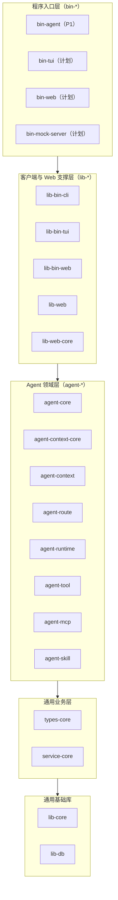
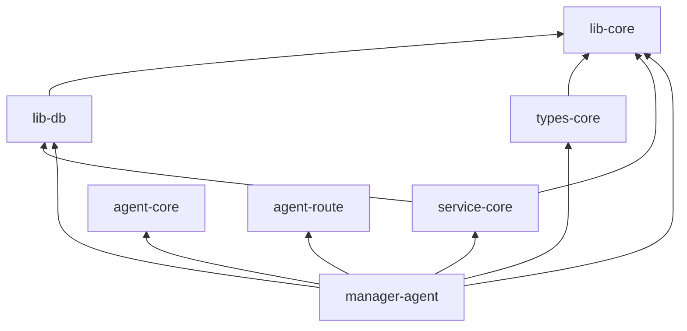
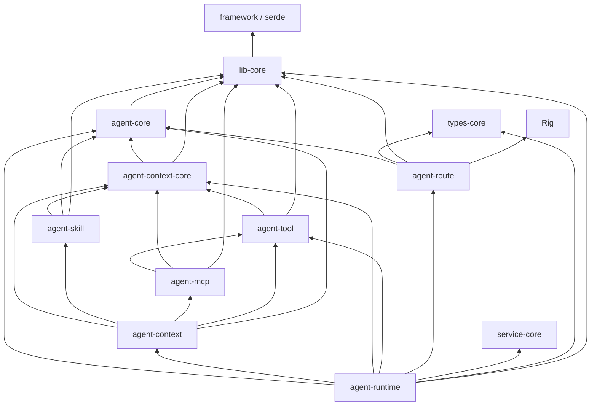
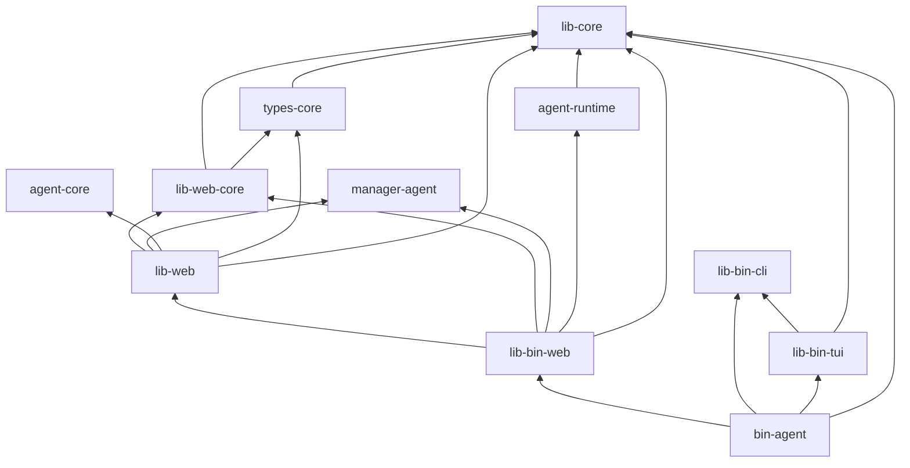
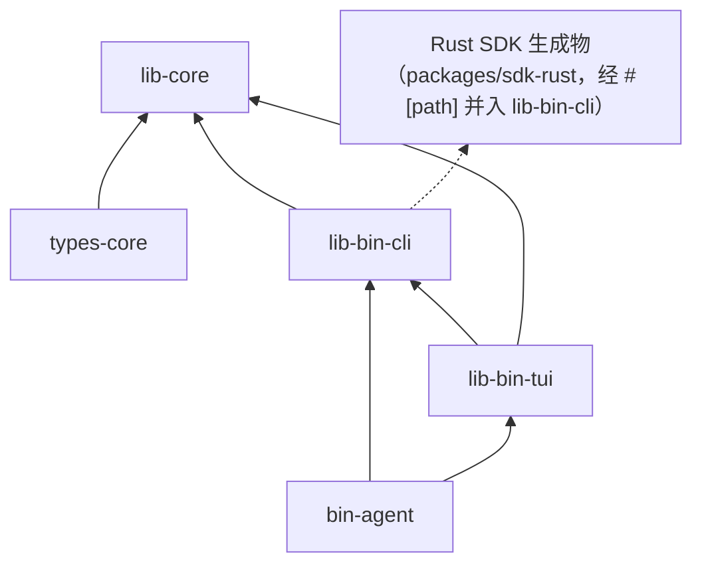

# Workspace 架构

本文档是本工作区 **Crate 成员、职责边界、依赖方向、类型组织与功能裁剪** 的唯一事实来源。

新增、移除、重命名 Crate，或变更任何 Crate 的职责与依赖方向时，必须同步更新本文档。

开发任务与阶段划分以 `.steps/` 为准，本文档不写任务清单。

---

## 一、Workspace 定位

本项目是一个用 Rust 实现的 **Personal Agent**，交付形态是**单体进程、单 Binary 分发**的 Agent Runtime。

架构立场：

1. **Modular Monolith**：单进程服务端，模块化拆分靠 Crate 边界与依赖方向保证，而不是靠网络边界。不提前拆微服务、不引入消息队列、不做分布式调度。
2. **Server 是唯一业务逻辑执行方**：Session、Message、Run、Context、Tool Execution 只由服务端管理；CLI / TUI / WebUI 都是纯客户端，不含 Agent Runtime 逻辑，不直接调用 LLM Provider，不执行 Tool。
3. **唯一跨进程边界是 HTTP（含 SSE）**。
4. **服务端 API 是契约的唯一来源**：TypeScript SDK 与 Rust Client SDK 必须从服务端 API 定义生成，客户端只允许自实现 HTTP Transport，不允许自维护 API 定义。
5. **第三方协议通过 Adapter 隔离**：Rig、MCP、LLM 供应商协议不进入 Agent Core。
6. **Native Binary 分发**：最终产物是可直接执行的文件，不要求用户预装 JVM / Python / Node 运行时。

Workspace 目标形态（逻辑视图）：



该图为**层次示意**，不代表完整依赖边；真实依赖以第五节为准。

---

## 二、分层原则

### 2.1 四大层次

| 层次 | Crate | 职责定位 |
|---|---|---|
| 通用基础库（lib） | `lib-core`、`lib-db`、`lib-web-core`、`lib-web`、`lib-bin-cli`、`lib-bin-tui`、`lib-bin-web` | 跨业务复用的基础能力、Web 适配、客户端与入口支撑 |
| 通用业务层（types/service） | `types-core`、`service-core` | 通用领域类型与通用核心业务服务 |
| Agent 领域层（agent） | `agent-core`、`agent-context-core`、`agent-context`、`agent-route`、`agent-runtime`、`agent-tool`、`agent-mcp`、`agent-skill` | Agent Runtime 与 Context、Tool、MCP、Skill 能力 |
| 程序入口层（bin） | `bin-agent`、`bin-tui`（计划）、`bin-web`（计划）、`bin-mock-server`（计划） | 组装与启动 |

另有开发期工具 `bin-tests`（源码位于 `crates/bin-tests`）：端到端测试入口，不属于上述四层，不参与分发，依赖 `lib-bin-cli` 的客户端能力、`lib-bin-tui` 的无终端驱动（`testing` feature）与 `manager-agent` 的运行时内核（P1.1 起在 `service-core`，P2-035 起迁入；用于在进程内驱动注册表、事件文件、断连链与轮转），通过子进程运行服务端，并用 `framework-http` 直连静态资源 / 预检这类不经过 SDK 的路径，直接用 `framework-proc-core` 的构建器校验 SDK 导出行为；前端单元与端到端用例也由它转发执行。

### 2.2 依赖方向表示法

全文统一使用：

```text
A -> B
```

表示 **A 依赖 B**（B 被 A 引用）。

### 2.3 依赖纪律（总则）

- 依赖只能自上而下：入口层 → 支撑/业务层 → 基础层。
- 禁止循环依赖，任何情况下都不得引入。
- 基础 Crate 不得反向依赖上层业务 Crate。
- Binary 只负责组装与启动，不得承载业务逻辑。
- 跨 Crate 只依赖**公开、稳定、职责明确**的接口。
- 第三方框架与协议尽可能通过 Adapter 隔离，不让其类型出现在上层契约中。

---

## 三、Crate 职责

### 3.1 通用业务层

#### types-core

通用领域类型。

职责：

- Settings 类型。
- Provider 类型。
- Model 类型。
- 通用配置类型。
- 通用业务 DTO。
- 通用业务枚举。
- 通用领域事件。
- 领域模块按领域分目录：`session`（会话 / 消息 / Run 契约）、`runtime`（客户端连接与会话占用契约，P1.1 起）。

边界（明确不做）：

- 不实现业务流程。
- 不实现数据库访问。
- 不实现 HTTP 请求。
- 不实现 Agent Runtime。

类型暴露约定：**仅需要参与 API 类型生成的类型才使用相应的 `#[auto_*]` 宏**，内部类型不要求使用。

#### service-core

通用核心业务服务。

职责：

- Session / Message / Run 业务服务与业务规则（P2 起，契约类型来自 `agent-core`）。
- 执行端口定义：`RunDriver` trait（P2-022），由 `agent-runtime` 实现、装配层注册。
- 对应业务持久化：`repository` 承载全部业务 SQL，事务边界经 `lib-db` 产生。
- Provider / Model 的配置装载与校验**不在本 Crate**：装载与校验归启动方 `lib-bin-cli`，
  只读的 `ProviderService` 与模型解析归 `agent-route`（D-P2-037）。

内部组织：

```text
service-core
    |
    +-- session/        会话业务入口（`service.rs`）、执行端口（`driver.rs`）与业务错误（`error.rs`）
    |
    +-- repository/     数据访问（SQL 与行映射），仅由本 Crate 的 service 调用
```

进程内运行时（客户端注册表、会话占用、事件文件、断连处理链、Run 执行队列）**不在本 Crate**：
P2-035 起迁入装配层 `manager-agent`，本 Crate 不感知 Agent 与事件通路。

边界：

- 不实现 Agent Loop、Context 组装、Tool 执行。
- 不实现 LLM 请求构造与调用（归 `agent-route`）。
- 不依赖任何 `agent-*` Crate。

#### manager-agent

Agent 装配、进程内运行时与跨 Service 编排（P2-013 / P2-035 起）。

职责：

- 启动装配：应用目录 → 数据库（迁移 + 残留 Run 自愈）→ Repository → Service → 运行时状态。
- 进程级 holder（`AgentHolder`）：持有 `session: Arc<SessionService>`、`runtime: RuntimeState`、
  `provider: ProviderService`（模型查找下沉在 `agent-route`）与 `agent: AgentConfig`，
  向 Handler 提供显式注入的访问入口（`install` / `holder` / `runtime` / `session` / `provider` / `agent`）。
- 进程内运行时：客户端注册表、会话占用、事件文件与轮转、断连处理链、心跳扫描（`runtime/`）。
- Run 执行：串行执行队列、取消信号登记与执行端口安装；事件生产自 P2-023 起由 `agent-runtime` 提供。
- 跨组件协调：发送消息后唤醒该会话的执行队列；停止运行时会话时取消未结束的 Run。
- 关闭入口：把「停全部客户端与运行时会话」交给断连处理链。

边界：

- 不承载业务规则（校验、状态机都在 `service-core`）。
- 不实现 Web / 传输逻辑（Handler 在 `lib-web`）。
- **`service-core` 不反向依赖本 Crate**：运行时状态与会话服务的互相引用在本层解决，
  `service-core` 内部只用显式参数传递。

内部组织：

```text
manager-agent
    |
    +-- assemble   启动装配（数据库、Repository、Service、运行时状态）
    |
    +-- holder     进程级 holder（AgentHolder）与关闭入口
    |
    +-- runtime    进程内运行时（注册表 / 占用 / 事件文件 / 断连链 / 定时任务）
    |
    +-- runner     Run 执行队列、取消信号登记与执行端口安装（生产方来自 `agent-runtime`）
    |
    +-- session    会话业务对外入口与唤醒协调
```

### 3.2 Agent 领域层

#### agent-core

Agent 领域的基础类型与抽象。

职责：

- Agent 定义。
- Agent 标识。
- Message。
- Turn。
- Run。
- Run Status。
- Agent Event。
- Agent Error。
- Agent 基础领域模型。

边界：不依赖具体的 Rig、MCP、Skill、HTTP 框架，不依赖 `agent-context-core` 及之上的任何 `agent-*` Crate。它是 Agent 领域最底层的类型来源。

#### agent-context-core

Agent Context 的基础抽象，是 Skill、MCP、Tool 等模块参与 Context 组装时共同遵循的稳定抽象层。

职责：

- Context 类型。
- Context Item。
- Context Source。
- Context Contribution。
- Context Metadata。
- Context Policy。
- Context 相关基础接口。

边界：只定义抽象与数据类型，不含具体组装流程、不做 token 预算计算、不发起 LLM 请求。

#### agent-skill

Agent Skills 能力（阶段：P5）。

职责：

- Skill Discovery。
- Skill Definition。
- SKILL.md 解析。
- Skill Metadata。
- Skill Loader。
- Skill References。
- Skill Instructions。
- Skill 对 Context 的贡献。

边界：只提供"任务知识"，不提供执行能力；Skill 声明所需 Tool，但不由本 Crate 执行 Tool。

#### agent-tool

统一 Tool System（P3 起落地）。

职责：

- Tool Trait。
- Tool Definition。
- Tool Schema。
- Tool Registry。
- Tool Executor。
- Tool Result。
- Tool Permission。
- Tool Execution Context。
- Tool Error。

边界与约定：

- **Tool 不等于 Context**：Tool 提供模型可调用的执行能力，Context 负责组织模型输入。
- 同时遵循 `agent-context-core` 的相关抽象，以便把 Tool Definition 等能力提供给 Context / Completion 请求的准备流程。
- 不依赖 `agent-runtime`；工具模块不得反向依赖运行时。
- 内置工具（`calculator` / `current_time` / `file_read` / `file_search` / `http_request`）位于 `builtin` 子模块，与 Tool 抽象同处本 Crate，不新建 `agent-tool-builtin`（`.steps/p3/decisions.md` D-P3-001）。
- 依赖 `framework-http` 仅为 `http_request`，本 Crate 不直接依赖 `reqwest`；契约 DTO 的 `auto_type` 依赖 `framework-proc-auto` / `framework-proc-core`（`collect` 特性，同 `types-core`）。
- P3 起 `service-core` 依赖本 Crate 承载审计记录与查询载荷（D-P3-011）；装配层把记录映射成契约快照时用的是 `service-core` 转发的类型，不新增依赖边（P3-019）。反向边均不成立。

#### agent-mcp

MCP 集成（阶段：P4）。使用 `rmcp`。

职责：

- MCP Client。
- MCP Server 配置。
- MCP Server 生命周期管理。
- Tool Discovery。
- MCP Tool Adapter。
- stdio Transport。
- Streamable HTTP Transport。
- MCP Error Handling。
- MCP 与内部 Tool System 的转换。

边界与约定：

- MCP 只是工具的一种来源：外部 Tool 经 Adapter 转换为内部统一 Tool，进入 `agent-tool` 的注册与执行体系。
- **不得让 MCP 协议类型渗透到 Agent Runtime 或更上层**。
- 未来需要把 MCP Resources / Prompts 纳入 Context 时，通过 `agent-context-core` 的抽象提供能力。

#### agent-context

Context 组装与管理实现。

职责：

- Context Builder。
- System Prompt Builder。
- Conversation History。
- Skill Context。
- Tool Definition Context。
- Memory Context（后续）。
- Token Budget。
- Context Ordering。
- Context Filtering。
- Context Compression（后续）。

边界：它是 Context 的具体组装与协调层，**不负责 Agent Loop，也不直接发起 LLM 请求**。

#### agent-route

Provider / Model 请求路由与模型调用适配。

职责：

- 根据配置解析 Provider。
- 根据配置解析 Model。
- 构造实际 LLM Provider。
- Rig Adapter。
- Completion Request。
- Streaming Response。
- Provider 选择。
- Model 选择。
- Fallback（后续）。
- 承载装载后的 Provider 配置（`ProviderService`）：`provider()` / `default_model()` / `model(id)`，
  未知模型返回 `LlmError::UnknownModel`，未配置 Provider 返回 `LlmError::Unconfigured`（P2-017）。

边界与约定：

- Provider 配置**没有**增删改查接口（D-P2-016 / D-P2-025，P2 只读 `config.toml`）；
  文件装载与启动期校验归启动方 `lib-bin-cli`，本 Crate 只承载装载结果（`ProviderService`）并做模型解析。
- **不得把 Provider 配置的装载与校验重复实现到 `agent-route`**。
- Rig 的类型必须被限制在本 Crate 的 Adapter 内，不得向上泄漏。

#### agent-runtime

整个项目的 Agent 执行引擎。

职责：

- Agent Loop。
- Run Lifecycle。
- Agent Execution。
- Context 构建协调。
- LLM 调用。
- Tool Calling。
- Tool Execution 协调。
- Tool Result Feedback。
- Stop Conditions。
- Max Iterations。
- Timeout。
- Cancellation。
- Streaming Events。

边界与约定：

- Runtime 不直接依赖具体 MCP 协议。
- Runtime 不直接解析 SKILL.md。
- Runtime 不负责 Provider 配置 CRUD。
- 通过 `agent-context`、`agent-tool`、`agent-route` 等抽象协调能力。

### 3.3 程序入口层

#### bin-agent

**P1 唯一需要实现的 Binary**，也是最终的单 Binary 入口。

职责：

- 统一入口：CLI、TUI、WebUI、Server。
- 通过命令行参数决定运行模式。

命令面示例（实际命令以 `.steps/p1/` 为准）：

```bash
agent
agent tui
agent server
agent run "Analyze this project"
agent status
```

边界：只做组装与启动；不实现业务逻辑，不直接调用 LLM Provider。

#### bin-tui（计划，不属于 P1）

未来的 CLI + TUI 独立发行入口。不含 WebUI，不内嵌静态资源。

#### bin-web（计划，不属于 P1）

未来的 CLI + WebUI 独立发行入口。不包含 TUI。

#### bin-mock-server（计划，不属于 P1）

模拟外部 LLM Provider，用于不依赖真实供应商的联调与测试。

职责范围：

- `POST /v1/chat/completions`
- `GET /v1/models`
- 普通 JSON 响应。
- SSE Streaming。
- 模拟 Tool Calls。
- 模拟错误。
- 模拟超时与延迟。

边界：

- 它就是"外部供应商"的替身，**与 P1 内部 Mock 的 Agent API 不是同一个服务**。
- **不得依赖 `agent-runtime`**，也不得依赖 `service-core` / `lib-web` 等业务与 Agent 能力。

#### bin-tests（开发期工具，不参与分发）

包名 `bin-tests`，源码位于 `crates/bin-tests`。

职责：

- 声明端到端测试用例，支持按用例名前缀选择与 `--all`。
- 以 CPU 内核数为默认并发度调度用例，单个用例失败不中断其余用例。
- 管理可复用测试资源：共享服务端只启动一次，供多个用例复用。
- 需要隔离状态或带副作用的用例自行启动独立服务端。
- 把运行汇总与每个用例返回的结果信息按领域汇总写入 `target/tests/<运行 ID>/`。
- 按用例声明的前置（`Case.prep`）在启动服务端之前去重执行运行期准备：目前是构建 WebUI 产物（`lingting-agent-ui/dist`），产物比源码新时跳过。
- 转发前端用例：`web.ui` 执行 `pnpm exec vp test run`（jsdom），`web.e2e` 执行 `pnpm exec playwright test`（真实 Chromium，服务端地址经 `WEBUI_BASE_URL` 传入）。
- 以无终端驱动覆盖 TUI 界面：按键迁移、输入编辑、渲染定位、流式展示与退出时的取消，不进入 raw 模式。
- 校验 SDK 生成器的导出行为：直接调用 `framework-proc-core` 的 `RustApiBuilder` / `TypescriptApiBuilder`，断言非法元数据（重名接口、重复 method+path）报错且合法输入幂等；不经过 `make gen` 的文件系统路径。

源码结构（P2.1-011 / D-P2.1-013）：`cases/` 只放用例（注册 + 断言 + 该用例独有的数据构造）；`mock/<领域>/` 放测试替身（当前只有 `llm`：最小 HTTP/1.1 实现、场景、观测记录，以及请求侧 `probe` 与观测侧 `observe`）；`util/` 平铺与领域无关的通用支持（`context` / `server` / `flow` / `support` / `paths` / `prepare` / `frontend` / `observability`）。入口与调度框架 `main` / `cli` / `runner` / `report` / `case` 留在顶层。依赖方向为 `cases -> {util, mock}`、`mock -> util`，三者都不得依赖 `cases`；`util::server` 需要共享 Mock 实例时按 `util -> mock` 单向引用。

边界：

- **不得进程内启动服务端**：服务端一律以 `bin-agent server` 子进程运行，测试进程只作为客户端。
- 不得直接依赖 `lib-web` / `lib-bin-web` / `service-core` 等服务端实现，只通过生成的客户端 SDK 访问服务端；`web.*` 断言静态资源、SPA 回落与 CORS 预检时改用 `framework-http` 直发原始请求（这些路径不经过 SDK），接口 path 仍复用生成物导出的常量。
- 不参与分发，不是产品入口。

替代方案记录：曾考虑用 `cargo test` + `cargo-nextest`。每个测试文件是独立进程，无法让多个用例复用同一个服务端，与“统一入口只启动一个共享服务端”的目标冲突，因此不采用。

### 3.4 通用基础库

`lib-bin-cli` / `lib-bin-tui` / `lib-bin-web` 都是 **Library Crate，不是可执行 Binary**：它们只向 `bin-*` 提供组装所需的能力，自身不产生可执行文件。

#### lib-core

跨 Crate 的公共基础能力。

职责：

- ID。
- 时间。
- 应用目录。
- 日志。
- 进程生命周期（关闭请求标记，`lifecycle` 模块）。
- 常量。
- 通用值类型。
- 通用工具方法。
- 其他真正通用的基础能力。

边界（严格）：

- **禁止把 Agent、Provider、业务 Service、Web API、Tool 等领域内容放入 `lib-core`**。
- "通用"的判断标准是：与业务领域无关，且被两个以上不同层次的 Crate 需要。

#### lib-db

数据库基础设施。

职责：

- SQLite。
- Database Connection / Pool。
- Migration（自建 runner，脚本编进二进制）。
- Transaction：`Database::begin` 产生事务句柄，`commit` / `rollback` 只由句柄提供（D-P2-034）。
- 数据库初始化。
- 通用数据库支持。

边界：

- 不负责业务 Repository 与业务 SQL（归 `service-core` 的 `repository`）。
- 事务边界只能由本 Crate 产生：业务代码不得直接调用 `sqlx` 的 `begin`，Repository 用 `with_xxx` 包装。

#### lib-web-core

Web 基础能力（参考 `lingting-ai-gateway` 的 `lib-web-core`）。

职责：

- Web Context。
- Request Context。
- Response 基础抽象。
- SSE 帧编码（`sse` 模块，P1-011 起）。
- Error Mapping。
- Request ID / Trace ID。
- Web Middleware。
- Cancellation Context。
- Axum 适配相关的基础 Web 能力。

边界：**尽量不依赖具体业务 Crate**；只依赖通用类型与基础库。

#### lib-web

服务端 HTTP API（参考 `lingting-ai-gateway` 的 `lib-web`）。

职责：

- 服务端 HTTP API。
- API 路由。
- Request / Response Handler。
- SSE Endpoint（P1.1 起只有 `GET api/client/stream` 一条下行通道）。
- 客户端连接与会话占用的运行时接口（`crates/lib-web/src/runtime/`，规则全在 `manager-agent::runtime`）。
- API Metadata 收集。
- 统一错误响应契约（`ApiError`，`auto_type`，随 SDK 生成导出；映射规则见 `docs/develop.md` 与 D-024）。
- 探活接口 `health` / `version`（P1 位于探针模块），以及仅 debug 构建注册的关闭联调接口 `shutdown`。
- Web Router 组装。
- 与服务端 API SDK 生成机制集成。

边界与约定：

- **服务端 API 是客户端 SDK 的唯一来源**：TypeScript SDK 与 Rust SDK 必须从服务端定义生成，不允许客户端自行维护 API 定义。
- 不拼装具体客户端的 Transport 实现。
- 不依赖任何 Binary。

#### lib-bin-cli

CLI 公共组件，同时承载客户端的共享能力。

职责：

- Clap 命令定义。
- 命令分发所需的公共能力。
- Server API Client 调用。
- 生成的 Rust SDK 接入。
- 客户端连接管理：注册、心跳、会话占用与下行流消费（P1.1 起）。
- 客户端错误处理。
- 配置装载（Server 地址、端口与日志级别，见 `docs/develop.md`）。

边界：不负责 Agent Runtime；不直接调用 LLM Provider；不执行业务逻辑。

#### lib-bin-tui

TUI 公共组件。

职责：

- Ratatui 应用。
- TUI 状态管理。
- 消息展示。
- Streaming 展示。
- 用户输入。
- 交互事件。
- TUI 与 Server 连接：先注册并建下行流，占用会话后发消息，退出前释放占用并反注册（P1.1 起）。
- 无终端驱动（`testing` feature）：供 `bin-tests` 驱动界面状态机、工作线程与渲染，不进入 raw 模式、不写备用屏幕。

边界：通过生成的 Rust SDK 请求 Server，不负责 Agent Runtime。

#### lib-bin-web

Web Server 启动与 WebUI 资源管理。

职责：

- Server Bootstrap。
- Web Router 启动。
- API 挂载。
- 请求日志的 trace id 作用域（`x-trace-id` 的透传由框架分发层负责）。
- WebUI 静态资源与 SPA 兜底（拦截器实现，`api/` 前缀保持 API 404）。
- CORS 白名单（仅本地回环来源）。
- Graceful Shutdown。
- Web Server 生命周期。

支持 Cargo Feature 控制是否内嵌 WebUI，例如：

```toml
[features]
default = []
embed-ui = ["dep:rust-embed"]
```

预期矩阵：

- `bin-agent`：启用 `embed-ui`。
- `bin-tui`：不启用 `embed-ui`。
- `bin-web`：启用 `embed-ui`。

**最终以真实 Cargo Feature 依赖关系为准**：必须注意 Cargo Feature Unification（同一构建中多个 Binary 共享依赖图时 feature 会合并），不能只根据声明推断 Binary 的依赖裁剪效果。

---

## 四、Service / Manager / Repository 组织规则

### 4.1 三层职责

| 组件 | 职责 |
|---|---|
| service | 面向调用方的业务入口，一个业务聚合对应一个 Service |
| manager | 同一 Service Crate 内部，跨多个 Service / Repository / 业务组件的流程编排 |
| repository | 数据访问，仅服务于本 Crate 的 Service |

### 4.2 Manager 归属规则

**当前不创建独立的 `manager-core`。**

1. 同一个 Service Crate 内部的 Manager，直接放在该 Crate 的 `manager` 模块：

```text
service-core
    |
    +-- service/
    |
    +-- manager/
    |
    +-- repository/
```

2. 同一 Service 内部的 Manager 可以协调多个 Service、Repository 或业务组件，但仍属于当前 Service Crate。
3. 只有出现**跨多个独立 Service Crate** 的业务协调时，才创建独立的 Manager Crate。
4. 需要跨 Service 协调时，形如：

```text
manager-agent
    |
    +-- service-core
    |
    +-- service-agent
```

依赖方向：

```text
manager-agent -> service-core
manager-agent -> service-agent
```

5. **Service Crate 不能反向依赖 Manager Crate。**
6. 命名按业务领域命名（如 `manager-agent`），**不要创建泛化的 `manager-core`**。

### 4.3 Repository 规则

- Repository 原则上**仅由当前 Crate 的 Service 使用**。
- Repository **不应成为其他 Crate 直接调用的公共业务接口**：跨 Crate 复用必须通过该 Crate 的 Service 暴露。
- Repository 只负责数据访问，不承载业务规则。

### 4.4 holder 规则

`holder`（共享状态持有者）**仅在确实需要跨调用共享状态时引入**，不预先创建。它能避免把共享状态提升为全局单例。

- 进程级 holder（`OnceLock<AgentHolder>`）只允许出现在**装配层**（P2 起是 `manager-agent`）。
- Service Crate（如 `service-core`）不持有进程级单例：需要共享的实例由装配层构造后**显式传入**，
  互相引用（运行时状态 ↔ 会话服务）也在装配层解决。

---

## 五、依赖方向

### 5.1 依赖清单（目标架构）

| Crate | 项目内依赖 | 外部依赖 | 禁止依赖 |
|---|---|---|---|
| `lib-core` | 无 | framework 基础能力 | 任何业务 / Agent / Web / Binary Crate |
| `lib-db` | `lib-core` | SQLite 驱动 | 业务 Repository、Agent Crate |
| `types-core` | `lib-core` | serde、`framework-proc-*`（生成用宏） | service / agent / web / bin |
| `service-core` | `agent-core`（仅类型层，P2 起）、`agent-tool`（仅类型层，P3 起：审计记录与查询载荷，D-P3-011）、`lib-db`、`lib-core` | ORM / 驱动（经 `lib-db`） | `agent-*` 中除 `agent-core` / `agent-tool` 以外的 Crate（不得依赖 `agent-runtime` / `agent-route` / `agent-context*`）、`manager-agent`、`lib-web*`、`bin-*`；也不承载进程内运行时（归 `manager-agent`） |
| `manager-agent` | `service-core`、`agent-route`（Provider 配置的只读承载，P2-017 起）、`lib-db`、`agent-core`、`types-core`、`lib-core`（P2-013 / P2-035 起） | Tokio、Anyhow、Tracing、`serde_json`（事件文件行格式）、`framework-bus`（断连通知）、`framework-timer` / `framework-proc-timer`（心跳扫描与事件文件轮转） | Web / 传输层（`lib-web*`、`lib-bin-*`、`bin-*`）；业务规则实现；模型解析（归 `agent-route`） |
| `agent-core` | `lib-core` | 无具体框架 | Rig、MCP、HTTP 框架、`agent-context-core` 及以上 |
| `agent-context-core` | `agent-core`、`lib-core` | 无具体框架 | Skill / Tool / MCP 的具体实现 |
| `agent-skill` | `agent-context-core`、`agent-core`、`lib-core` | YAML / Markdown 解析 | `agent-runtime`、`agent-tool` 实现细节 |
| `agent-tool` | `agent-core`、`agent-context-core`、`lib-core` | `schemars`（参数 schema 生成）、`framework-http`（仅 `http_request`，启用 `reqwest` 后端）、`url`（`http_request` 的地址解析与 host 白名单匹配）、`chrono`（`current_time` 的 ISO8601 格式化）、`anyhow`（`http_request` 的错误归一化，框架以 `anyhow::Result` 返回）、`framework-proc-auto` / `framework-proc-core`（契约 DTO 的宏与元数据，开 `collect`）、Tokio、`async-trait`、`futures-util`、serde | `agent-runtime`、`agent-route`、`agent-mcp`、`rig-core`、`service-core`、`lib-web*`、`bin-*` |
| `agent-mcp` | `agent-tool`、`agent-context-core`、`lib-core` | `rmcp` | `agent-runtime`、`agent-context` |
| `agent-context` | `agent-context-core`、`agent-core`（P2 实际；`agent-skill` / `agent-mcp` / `agent-tool` 于 P3–P5 接入） | `tracing`（系统提示词扫描与选中的日志）；无 LLM SDK | `agent-runtime`、`lib-web*` |
| `agent-route` | `agent-core`、`types-core`、`lib-core` | Rig（`rig-core`） | `agent-runtime`、`service-core`（D-P2-018 已删除该边）、`lib-web*` |
| `agent-runtime` | `agent-core`、`agent-context`、`agent-context-core`、`agent-route`、`service-core`（经其 Service 持久化 Run / Message，P2 起）、`types-core`、`lib-core`（`agent-tool` 于 P3 接入） | Tokio、`tokio-util`（取消信号）、`async-trait`（实现执行端口）、Tracing | `lib-web*`、`lib-bin-*`、`bin-*`；不直接写 SQL |
| `lib-web-core` | `lib-core`、`types-core` | `framework-web`、serde、`serde_json`（SSE 帧编码） | `lib-web`、业务 Service、Agent Runtime |
| `lib-web` | `lib-web-core`、`manager-agent`（会话业务入口、运行时状态与装配结果，P2-035 起）、`agent-core`（契约类型，P2 起）、`types-core`、`lib-core` | `framework-web-axum`、`framework-web`、`framework-proc-auto`、`framework-proc-core`（宏展开的绝对路径依赖，必须直接声明并开 `collect`；`framework-proc-core` 另开 `ts` / `rust` 供 SDK 生成器使用。注：`framework-proc-ts` 已被上游删除）、`bytes`、`futures-util`（组装 SSE 响应体）、Tokio（下行流的保活定时器与通道接收端） | `lib-bin-*`、`bin-*`；不直接持有进程级单例（holder 归 `manager-agent`）；不依赖 `agent-runtime`（事件流经 `manager-agent` 的运行时状态取得） |
| `lib-bin-cli` | `lib-core`、`types-core`、`packages/sdk-rust` 生成的模块（经 `#[path]` 引入，**不是** Cargo 依赖） | `framework-http`（HTTP 收发，启用 `reqwest` 后端）、Clap、Serde、`serde_with`、`toml`、`anyhow`、`tracing-subscriber`、Tokio（客户端命令的运行时）、`url`（查询串编码） | Agent Runtime、服务端业务实现、`lib-web`（生成期的服务端 crate 不得成为客户端的编译/运行依赖）；也不得直接依赖 reqwest 发请求（HTTP 只经 `framework-http`） |
| `lib-bin-tui` | `lib-bin-cli`、`lib-core` | Ratatui、Tokio（工作线程的异步运行时）、`unicode-width`（显示宽度与折行） | Agent Runtime、服务端业务实现 |
| `lib-bin-web` | `lib-web`、`lib-web-core`、`manager-agent`（启动装配、注入与关闭，P2-035 起）、`agent-runtime`、`lib-core` | `framework-web`、`framework-web-axum`、`async-trait`（实现框架拦截器）、`framework-timer`（启动心跳扫描与事件文件轮转任务）、Tokio、Tracing、Anyhow、`rust-embed`（可选） | Agent Runtime 的业务方法调用（只做构造与注入）、业务逻辑 |
| `bin-agent` | `lib-bin-cli`、`lib-bin-tui`、`lib-bin-web`、`lib-core` | — | 直接实现业务逻辑 |
| `bin-tui`（计划） | `lib-bin-cli`、`lib-bin-tui`、`lib-core` | — | `lib-bin-web`（不内嵌 WebUI） |
| `bin-web`（计划） | `lib-bin-cli`、`lib-bin-web`、`lib-core` | — | `lib-bin-tui` |
| `bin-mock-server`（计划） | `lib-web-core`、`lib-core` | Axum / `framework-web-axum` | `agent-runtime`、`service-core`、`lib-web` |
| `bin-tests` | `lib-bin-cli`、`lib-bin-tui`（`testing` feature）、`manager-agent`、`service-core`、`types-core`、`agent-core`、`lib-core` | Clap、Tokio（子进程、网络监听、并发与超时）、`framework-http`（`reqwest` feature，直连非 SDK 路径）、`framework-timer`（校对定时任务注册）、`framework-proc-core`（`ts` + `rust` feature，校验导出构建器）、`serde_json`（解析错误体与内置 Mock LLM 的请求体）、`futures-util`（panic 兜底）、`anyhow` | `lib-web`、`lib-bin-web`（不得进程内启动服务端）；`manager-agent` 与 `service-core` 只用于进程内驱动运行时内核（注册表、事件文件、断连链、轮转）与会话业务，不得用它们装配 Web 服务；不得把 `bin-agent` 作为库依赖（只能以子进程运行） |

### 5.2 依赖图

#### 通用业务



#### Agent 领域



#### 服务端与入口



#### 客户端



客户端严格约束：

- 客户端只通过**生成的 SDK** 调用服务端，Transport（reqwest 封装、SSE 解析、超时、重试）由客户端自己实现。
- 客户端 DTO 由**同一份服务端定义生成**（`auto_type` 定义快照），Rust 侧自带快照、不依赖服务端 crate；因此客户端不产生对 `lib-web` 的编译期或运行期依赖。
- 客户端不得调用服务端的业务逻辑，也不得 link 服务端执行 Agent 的代码路径。
- 生成物落位：`packages/sdk-rust`（由 `lib-bin-cli` 用 `#[path]` 引入）与 `packages/sdk-ts`（由 `lingting-agent-ui/` 内的 pnpm workspace 消费），二者均不入库，生成命令为根 `Makefile` 的 `make gen`，必须在 `make build` / `make ui-install` 之前执行。

### 5.3 详细依赖约束

1. `agent-core` 不依赖具体基础设施。
2. `agent-context-core` 是 Context 相关扩展的稳定抽象。
3. `agent-skill`、`agent-tool`、`agent-mcp` 可以依赖 `agent-context-core`。
4. `agent-mcp` 使用 `agent-tool` 作为内部工具适配目标。
5. `agent-context` 负责协调 Skill、MCP、Tool 对 Context 的贡献。
6. `agent-runtime` 负责调用 `agent-context`、`agent-tool`、`agent-route`，并通过 `service-core` 的 Service 持久化 Session / Message / Run（P2 起）；Runtime 不直接写 SQL。
7. Provider / Model 配置由启动方 `lib-bin-cli` 装载与校验，交给 `agent-route` 的 `ProviderService` 只读承载；`agent-route` 不依赖 `service-core`（D-P2-018 删除该边，D-P2-037 归位）。
8. `service-core` 不反向依赖 `agent-runtime`、`agent-route`、`agent-context*`；自 P2 起允许依赖 `agent-core` **且仅限其类型层**（契约类型迁移后的必然结果）。
9. 工具模块、MCP 模块不得反向依赖 `agent-runtime`。
10. `lib-web-core` 不反向依赖 `lib-web`。
11. `lib-web` 不依赖 Binary。
12. `lib-bin-web` 负责启动和组合 Web 能力。
13. Binary 负责最终组合不同入口。
14. 启动装配（构造 Repository、Service、Runtime 并注入）由 `lib-bin-web` 完成；它不得调用 Runtime 的业务方法，业务动作一律经 `lib-web` 的 Handler → Service / Runtime。
15. `agent-route` 是唯一允许依赖 Rig 的 Crate，且 Rig 类型不得离开其 Adapter 模块。
16. `lib-db` 只提供连接、迁移与事务，不含业务表与业务 SQL；业务 SQL 归 `service-core` 的 `repository`。

### 5.4 禁止依赖关系

- 禁止循环依赖。
- 基础 Crate 不得反向依赖上层业务 Crate。
- `agent-core` 不得依赖具体 Web 框架、Rig、MCP、TUI、CLI。
- 业务 Crate 不得依赖 TUI / CLI / WebUI。
- Binary 只负责组装和启动，不得承载业务逻辑。
- 不允许因为方便就把通用能力放到 `lib-core`。
- 不允许用 `types-core` 替代所有领域 Crate 的类型组织。
- 不允许通过共享全局状态绕过 Crate 依赖边界。
- Crate 之间优先依赖公开、稳定、职责明确的接口。
- 第三方框架和协议尽可能通过 Adapter 隔离。

---

## 六、类型组织与 API 暴露约定

### 6.1 不创建 types-api

**明确不创建 `types-api`。** 理由：

1. 项目内部类型暴露没有问题。
2. 仅通过 `#[auto_*]` 框架宏标记需要参与 API 类型生成的类型。
3. 内部类型不要求使用这些宏。
4. 不需要为了 HTTP API 再维护一份 DTO 类型体系。
5. Server API、TypeScript SDK、Rust SDK 继续遵循已确定的服务端单一来源机制。

### 6.2 类型归属

类型按所属**领域**放在对应 Crate：

| 类型类别 | 归属 |
|---|---|
| 通用配置、Provider / Model 类型、通用业务 DTO 与枚举 | `types-core` |
| Agent 定义、Message、Turn、Run、Agent Event / Error | `agent-core` |
| Context 相关类型 | `agent-context-core` |
| Tool 相关类型 | `agent-tool` |
| Skill 相关类型 | `agent-skill` |
| MCP 相关类型 | `agent-mcp` |

### 6.3 暴露规则

- 哪些类型需要暴露给 API，**由该类型是否使用对应 `#[auto_*]` 宏决定**。
- 不允许额外创建一套与内部类型重复的 API DTO。
- 客户端 SDK 的 DTO 来自服务端同一份定义；客户端不得自行维护 API 定义。
- 生成物头部必须带"自动生成，勿手改"标记，合并冲突时一律重新生成。
- API 定义变更后必须重新生成 SDK，并由一致性检查门禁拦截漏生成。

---

## 七、Cargo Feature 与 Binary 功能裁剪

### 7.1 原则

1. **P1 优先"一个文件能跑通"**，不为体积提前引入 feature 矩阵。
2. 只有确实需要区分发行形态时，才通过 Cargo Feature 裁剪功能。
3. Feature 的命名按**能力**命名（如 `embed-ui`），不按 Binary 命名。
4. 必须验证真实依赖裁剪效果，不能只根据声明推断：
   - Cargo Feature Unification 会在一次构建中合并多个目标所需的 feature。
   - 若同一次构建同时包含 `bin-agent` 与 `bin-tui`，`embed-ui` 会被合并开启。
5. 体积阈值与判断依据在记录基线数据后确定。

### 7.2 WebUI 嵌入 Feature

```toml
[features]
default = []
embed-ui = ["dep:rust-embed"]
```

- 开发模式：静态资源从本地目录读取（便于前端热更新）。
- 发布模式：静态资源编译期嵌入，单文件部署无需携带静态目录。
- 无论哪种模式，对外的资源访问接口保持一致。

---

## 八、阶段范围：当前实现与未来计划

目标架构包含的 Crate **不要求一次性创建**。创建顺序严格跟随 `.steps/` 路线图。

### 8.1 当前实际实现范围（P1 / P1.1 / P2 / P3）

| Crate | 阶段 | 说明 |
|---|---|---|
| `bin-agent` | P1 | 唯一 Binary |
| `lib-bin-cli` | P1 | CLI 与客户端共享能力（P2 起含 `[provider]` / `[agent]` 配置装载与校验） |
| `lib-bin-tui` | P1 | TUI |
| `lib-bin-web` | P1 | Web Server 启动、装配与资源（P2 起调 `manager-agent::assemble` 并注册执行端口） |
| `lib-web` | P1 | 服务端 HTTP API |
| `lib-web-core` | P1 | Web 基础能力 |
| `types-core` | P1 | 通用领域类型（`session` 契约已于 P2 迁出） |
| `service-core` | P1 / P2 | P1 为内存 Mock 存储；P2 起为 Service + Repository，并定义执行端口 |
| `lib-core` | P1 | 公共基础能力 |
| `manager-agent` | P2 | 装配、进程级 holder、进程内运行时与 Run 执行队列 |
| `lib-db` | P2 | SQLite、迁移与事务 |
| `agent-core` | P2 | Session / Message / Run 契约类型 |
| `agent-route` | P2 | Provider / Model 解析、`ProviderService` 与 Rig Adapter |
| `agent-context-core` | P2 | Context 抽象 |
| `agent-context` | P2 | Context 组装与裁剪 |
| `agent-runtime` | P2 | Agent Loop、执行端口实现与全局并发限制 |
| `agent-tool` | P3 | Tool Trait / 定义 / Schema / 注册表 / 执行器与内置工具 |
| `bin-tests` | P1 | 开发期测试入口（`crates/bin-tests`），不参与分发 |

P1 的 SDK 生成器与探针服务不单独建 crate，统一以 `crates/lib-web/examples/` 形式存在（`api_probe_server`、`gen_sdk`；生成逻辑与其共用输出处理在 `examples/support/`）；生成物落 `packages/`（不入库），由 `make gen` 一条命令产出。

阶段裁剪的历史与现状：

- P1 的 `service-core` 用内存 Mock 存储，`lib-db` 于 P2 创建；P2-013 起 `service-core` 变成「Service + Repository」，进程内运行时与进程级 holder 迁入装配层 `manager-agent`。
- Session / Message / Run 的契约类型在 P1 落在 `types-core` 的 `session` 模块，P2-006 整体迁入 `agent-core`（类型名与字段不变）。见 `.steps/p1/decisions.md` D-025。
- P1.1 的运行时内核按领域落模块，不新增 Crate：客户端连接与占用契约在 `types-core` 的 `runtime` 模块，注册表、占用、事件文件、断连处理链与定时任务自 P2-013 起在 `manager-agent` 的 `runtime` 模块，`lib-web` 的 `runtime` 模块只做 Handler、帧合成与错误映射。见 `.steps/p1.1/decisions.md` D-P1.1-001 ~ D-P1.1-004。
- `lib-web` 在 P1.1 与 P2 都不依赖 `agent-runtime`：事件流与执行状态经 `manager-agent` 的运行时状态取得。

### 8.1.1 P2 落地的依赖边

P2 路线图（`.steps/p2/`）确定新增 `lib-db`、`agent-core`、`agent-context-core`、`agent-context`、`agent-route`、`agent-runtime`、`manager-agent`，落地后的实际依赖边（与 5.1 一致）：

| 边 | 说明 |
|---|---|
| `service-core -> agent-core` | 仅类型层；契约类型从 `types-core::session` 迁入 `agent-core` 后成立 |
| `agent-runtime -> service-core` | Runtime 经 Service 持久化 Run / Message，不直接写 SQL |
| `manager-agent -> service-core` / `lib-db` / `agent-route` | 启动装配、进程级 holder、跨组件协调与 Provider 只读承载 |
| `lib-web -> manager-agent`、`lib-bin-web -> manager-agent` | Handler 的会话业务入口与装配结果；启动方只调装配入口 |
| `lib-bin-web -> agent-runtime` | 只构造 `AgentRuntime` 并注入执行端口，不调用其业务方法 |

与早期盘点不同的两条：

- `agent-route -> service-core` **不存在**：Provider / Model 配置由 `lib-bin-cli` 装载与校验，`agent-route` 只做只读承载（D-P2-018 / D-P2-037）。
- `lib-web -> agent-runtime` **不存在**：事件仍按 P1.1 通路经 `manager-agent` 落盘再转发。

`RunEventStream` 已被 P1.1 删除（事件下线只剩 `api/client/stream`）；进程级 `holder` 先由 `service-core` 迁出，P2-013 落在装配层 `manager-agent`（不在 `lib-web`），仍是启动期显式初始化。决策依据见 `.steps/p2/decisions.md` D-P2-018 / D-P2-019 / D-P2-032。

### 8.2 后续阶段创建范围

| 阶段 | 新增 Crate | 状态 |
|---|---|---|
| P3 | `agent-tool` | 已创建（P3-001） |
| P4 | `agent-mcp` | 未创建 |
| P5 | `agent-skill` | 未创建 |
| P6 及以后 | 按需评估，可能包含跨 Service 的 `manager-<domain>` | 未创建 |

### 8.3 阶段实现与目标依赖的差异

目标依赖图刻画的是**最终形态**。阶段实现时，某些 Crate 尚未存在，此时：

- **允许**在阶段内只依赖当前已存在的 Crate（如 P2 的 `agent-context` 只协调 Context 基础抽象与 Conversation History）。
- **不允许**为了满足目标依赖图而提前创建尚未进入阶段的 Crate。
- **不允许**为了让图"完整"而在某个 Crate 中预先写死对尚未存在能力的具体实现。
- 当某个依赖的目标方尚未实现时，应通过抽象接口占位，并在其所属阶段接入实现。

P2 已明确的 Non-goals（Tool / MCP / Skills / Memory）意味着 `agent-context` 在 P2 不应引入 Tool、MCP、Skill 的具体依赖；相关贡献在 P3 / P4 / P5 通过 `agent-context-core` 的抽象逐步接入。

### 8.4 计划中的 Binary

`bin-tui`、`bin-web`、`bin-mock-server` 是**未来规划**的独立发行或测试入口：

- P1 **不创建**这些 Binary，也不为它们预先增加代码实现。
- 它们的职责与未来定位记录在本文档第 3.3 节，但不代表已实现。
- 在 `bin-agent` 已能覆盖全部入口的前提下，是否需要真正发行独立 Binary，留到发布阶段评估。

---

## 九、新增 Crate 的判断标准

新增 Crate 前必须依次回答：

1. **现有 Crate 是否已能承载？** 能在现有职责内解决，就不新增。
2. **是否有明确的业务领域或技术边界？** 只有"方便一点"不构成理由。
3. **依赖方向是否成立？** 新增 Crate 的依赖必须符合第五节，且不引入环。
4. **是否会造成类型重复？** 不得因为新增 Crate 而复制 DTO、协议类型或领域模型。
5. **是否有明确的创建阶段？** 不在当前阶段的，不创建。
6. **是否属于已明确禁止的形态？** `manager-core`、`types-api` 一律不得新增；泛化的 `util` / `common` / `core` 这类无领域含义的 Crate 同样不允许。
7. **命名是否表达领域？** 使用 `agent-*` / `lib-*` / `bin-*` / `<domain>-*` 前缀，命名体现领域而非抽象层次。
8. **是否需要更新本文档？** 在动手之前先更新，而不是事后补。

跨 Service 业务协调的判断：

- 协调只发生在**同一个 Service Crate 内部** → 放在该 Crate 的 `manager` 模块。
- 协调跨越**多个独立 Service Crate** → 才考虑新建 `manager-<domain>`。

---

## 十、架构变更与文档同步

1. 新增、移除、重命名 Crate 时，必须同步更新本文档：成员清单、职责、依赖方向。
2. 变更某 Crate 的职责边界时，必须同步更新该 Crate 的职责描述与依赖清单。
3. 变更依赖方向时，必须检查并更新全部依赖图，确认无循环依赖。
4. 阶段推进导致"Crate 已实现 / 尚未实现"状态变化时，必须更新第八节。
5. 本文档与 `.steps/` 冲突时：**架构与依赖以本文档为准，任务与阶段划分以 `.steps/` 为准**；若冲突属于架构决策层面，先讨论再修改，不得单方面改动 `.steps/`。
6. 本文档不写开发任务与验收标准。

---

## 十一、待确认事项

以下问题在本文档中已按当前决策给出最小可行的处理方式，但仍需在进入对应阶段前确认：

1. **客户端 SDK 生成物的落位（P1-006 落定，P1-007 已复核：维持不建独立 crate、不入库）**：Rust SDK 生成物放 `packages/sdk-rust`，由 `lib-bin-cli` 用 `#[path]` 作为自身模块引入（不建独立 crate、不加 path 依赖、不入库）；TS SDK 放 `packages/sdk-ts`，由 `lingting-agent-ui/` 内的 pnpm workspace 引入。若后续要把生成物变成独立 Crate，必须同时解决「path 依赖的 manifest 先于生成存在」的引导死锁（方案：入库该 crate，见 `docs/reports/p1-006-rust-sdk.md` 第 2 节），属架构变更，须先更新本文档。
2. **`lib-bin-tui -> lib-bin-cli` 依赖**：为保证 TUI 复用同一套 SDK 接入与连接管理，此处补充了该依赖。若后续希望 TUI 不依赖 CLI 命名下的 Crate，需要调整命名或拆分客户端共享层。
3. **`lib-web-core` 依赖 `types-core`**：用于承载跨端错误契约等通用类型。若希望 `lib-web-core` 完全不依赖业务类型层，需要把这些契约类型另行归位。
4. **`agent-tool` 是否依赖 `agent-core`**：P3-001 定稿**依赖**（仅类型层）——工具轨迹最终要与 Agent 领域的 Run / Message 契约共用同一套类型来源，本 Crate 不自造；Batch A 尚无引用点，且仍禁止依赖 `agent-runtime` / `agent-route` / `rig-core`。
5. **`bin-mock-server` 的依赖面**：当前限定为 `lib-web-core` + `lib-core`，明确不得依赖 `agent-runtime` 与 `service-core`。
6. **feature 裁剪的真实效果**：`embed-ui` 的实际裁剪效果必须在依赖图确定后验证，不能只依据声明推断。
